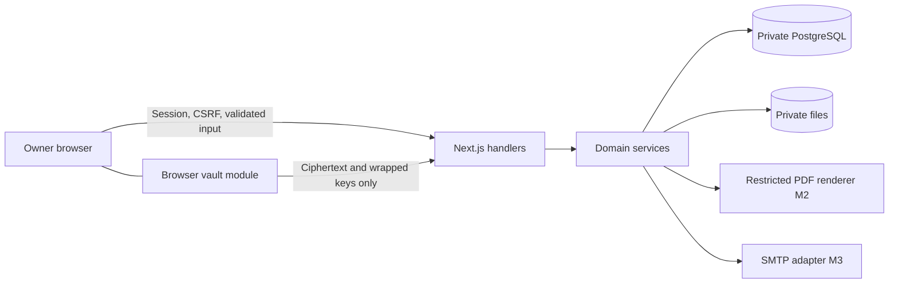
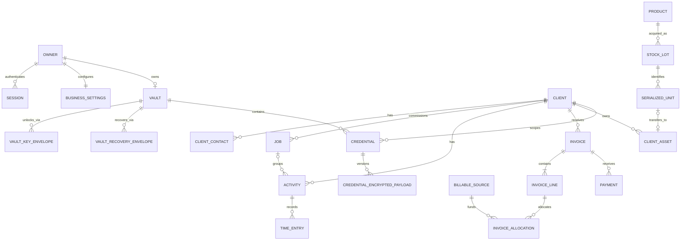

# SideDesk: architecture, schema, security review, and Milestone 0 plan

Prepared 23 October 2026. Status: historical pre-implementation proposal. Actual choices through M3 are recorded in [implementation decisions](implementation-decisions.md); this review remains preserved for context.

## Source and repository findings

Repository: [Kaden-Birch/SideDesk](https://github.com/Kaden-Birch/SideDesk), default branch `main`. The GitHub connector returned a root containing only `README.md`; fetching `docs/SIDEDESK_SPEC.md` returned 404. The connector reports `pull: true`, `push: false`. No remote files were changed.

I read all 341 lines of the supplied `SideDesk_Codex_Specification.md`, including sections 1–13, the acceptance matrix, and the end marker. This review uses that attached v1.0 specification because the requested repository copy is absent. The DOCX was supplied as an alternative representation; equivalence between the two files has not been verified. Before implementation, preserve the Markdown verbatim as `docs/SIDEDESK_SPEC.md` and record its source/hash. Do not imply the absent repository document was read.

The user's chat request controls this work. Instructions embedded in the attachment are specification content; they do not independently authorize actions outside the requested review. This deliverable contains design proposals, not application code. Milestone 0 has not been implemented or declared complete, and no runtime, Docker, migration, or security tests have been claimed.

## 1. Proposed implementation architecture

### Application shape

Use one structured TypeScript application, deployed as a modular monolith. One owner and one business need no tenant infrastructure, distributed services, Redis, public APIs, or separate frontend deployment.

| Layer | Proposed choice | Reason / boundary |
|---|---|---|
| Web | Next.js App Router, React, strict TypeScript | Server-render ordinary pages; client components for interactive forms and vault operations. Node runtime for database/files/auth. |
| UI | Tailwind CSS and locally owned shadcn/ui primitives | Shared semantic tokens, accessible dialogs/drawers/tables; system/light/dark preference. |
| HTTP | Explicit typed route handlers validated with Zod | Thin authentication/CSRF/validation layer calling domain services. Never trust client totals or ownership assertions. |
| Domain | Feature services with explicit transaction boundaries | Clients, work, sales, inventory, expenses, vault, reporting; no business rules buried in React. |
| Persistence | PostgreSQL with Drizzle and reviewed SQL migrations | SQL visibility for partial indexes, row locks, checks, triggers, and composite foreign keys. |
| Authentication | Opaque random server sessions; Argon2id login verifier | Immediate revocation, one-owner enforcement, no third-party identity dependency. Prefer established libraries for primitives. |
| Files | Private persistent local volume | Random opaque storage keys; authenticated downloads; never under `public/`. |
| Vault | Browser-only crypto module/worker; server ciphertext repository | Server authenticates and stores opaque envelopes; never receives unlock/recovery credentials. |
| PDF, M2+ | Server-controlled HTML rendered by pinned Chromium/Playwright | One print template, immutable stored PDF, A4/Letter and multipage verification. Restrict network/file access. |
| Email, M3 | SMTP adapter with persisted send attempts | Distinguish queued, failed, and SMTP-accepted; no delivery guarantee. |
| Tests | Unit runner, real PostgreSQL integration tests, Playwright e2e | Database invariants tested against PostgreSQL, not SQLite approximations. |
| Operations | Docker Compose app + PostgreSQL; one-shot migration command | Persistent DB/uploads, private DB network, health checks, non-destructive upgrades. |

Drizzle documents both [SQL migrations](https://orm.drizzle.team/docs/migrations) and [transactions](https://orm.drizzle.team/docs/transactions). Next.js supports [self-hosting](https://nextjs.org/docs/app/guides/self-hosting); its reverse-proxy recommendation does not change SideDesk's explicit requirement that direct HTTP deployment remain supported. Exact dependency versions, runtime compatibility, licenses, and security advisories must be checked and pinned when implementation begins.

Vault code has a separate client-only entry point with import boundaries preventing server imports. Decrypted secrets must never enter server components, server actions, form posts, generic query caches, debugging stores, error reporting, or SSR hydration. Ordinary client/job DTOs explicitly select safe fields rather than serializing ORM relationships. All authenticated responses and vault responses use appropriate private/no-store policies; service workers must not cache vault data.

Use the specification's directory layout: `app/`, `components/`, `features/`, `lib/`, `db/`, `public/`, `scripts/`, `tests/`, and `docs/`. Keep `lib/security/` and `features/vault/crypto/` narrow and separately reviewed. Record choices in `docs/architecture-decisions.md`.

### UI contract

Use a 240px expanded sidebar, 64px icon rail, 1440px content maximum, 24–32px desktop gutters and 16px mobile gutters. Body text 14–15px, headings 20–28px, metadata 12–13px; system fonts initially avoid external font requests. Use neutral surfaces, muted blue accent, 8–10px radii, tabular numeric text, semantic status labels, and visible keyboard focus. Mobile targets are at least 40–44px.

Build semantic tokens for backgrounds, raised surfaces, borders, text, focus, primary, success, warning, danger, and info. Test light/dark/system modes across validation, loading, empty, error, dialogs, menus and settings. No decorative gradients, oversized tiles, fictitious metrics, or remote scripts.

The complete product sidebar follows the specification. In M0, expose functioning Dashboard and Settings routes; show future modules as clearly labelled noninteractive roadmap text if needed. Do not present dead links, fake search results, an inert timer, or a `+ New` menu whose actions do nothing. Introduce these controls as their underlying features land. This staged navigation interpretation needs acceptance because the specification simultaneously prescribes the full shell and prohibits placeholders.

## 2. Initial database schema and relationships

### Common conventions

Use application-generated UUID primary keys. Mutable records have `created_at`, `updated_at`, integer `version`, and optional `archived_at` when safe. Append-only events have creation timestamps and sequence/event IDs; do not pretend their values are mutable. Use `timestamptz` for instants, `date` for business dates, UTC storage, and business timezone presentation (default `America/Edmonton`).

Store money as signed `bigint` minor units plus three-letter currency; validate limits before conversion and serialize bigint safely as decimal strings. Rates/quantities/distances use bounded PostgreSQL `numeric` with explicit scales. Perform financial arithmetic server-side using decimal math and a documented rounding policy. Do not sum different currencies; default to CAD. Client-supplied totals are never authoritative.

An `owner_id` foreign key expresses ownership where useful; it does not introduce multiple accounts or tenancy. Singleton constraints enforce one owner and one business. Across client-scoped records, composite foreign keys such as `(job_id, client_id)` prevent linking another client's job accidentally. Default deletion is restricted for historical references; archive clients, and preserve document snapshots.

### M0 physical schema

Only these foundation tables need migrations in M0. The later tables below are the initial target design and receive migrations in the milestone introducing their behavior.

| Table | Principal fields and constraints |
|---|---|
| `owner` | `id`, `singleton_key` CHECK = 1 UNIQUE, `login_name` UNIQUE, `password_hash` (encoded Argon2id salt/params/verifier), timestamps, `version`. No registration endpoint after creation. |
| `installation` | Singleton row created by migration; `owner_id` nullable UNIQUE FK, setup progress/completion timestamps. Lock this row during owner creation. Public setup closes as soon as owner exists; authenticated owner can resume incomplete configuration. |
| `session` | `id`, `owner_id` FK, UNIQUE hash of opaque session token, creation/last-seen/idle/absolute expiry, `revoked_at`, CSRF binding. Never store raw bearer token. Index token hash and expiry. |
| `business_settings` | Singleton `id`, `owner_id` UNIQUE FK, identity/contact, private logo reference later, `currency` default CAD, timezone, hourly rate minor units, rounding increment/scope, invoice prefix, payment terms/instructions, tax-enabled flag, registration details, `version`. No assumed GST registration. |
| `security_preferences` | `owner_id` PK/FK, HTTPS recommendation dismissal/version, vault inactivity preference, optional background-lock preference; no keys. |
| `auth_rate_limit` | Hashed login/IP bucket, window start, count, blocked-until, expiry. Shared server-side state survives restart; bounded cleanup. Avoid permanent account lockout. |
| `general_audit` | `id`, nullable owner FK for pre-auth events, enumerated event type, outcome, timestamp, request correlation ID, allowlisted safe metadata. No arbitrary request bodies or secret-bearing error objects. |
| `backup_run` | ID, state, start/finish timestamps, server-generated manifest/storage references, safe failure code. User input cannot execute commands or choose arbitrary host paths. |

Backup root is deployment-configured inside an allowed mounted directory. The wizard can select a relative destination, show diagnostics, and run a real test. Do not store deployment secrets in ordinary settings tables.

### Clients, work, and contextual data (M1–M2)

| Table | Principal fields / relationships |
|---|---|
| `client` | Owner FK, person/business type, display/legal names, billing address, status, default rate/terms, contact summary, version/archive. |
| `client_contact` | Client FK, name, role, email, phone, primary flag; these are ordinary business contacts, not credential usernames. |
| `job` | Client FK, title/description, status, priority, due date, rate override, optional originating quote/version. |
| `activity` | Client FK, nullable Job FK with matching client, title, status, billable flag; job never required for quick work. |
| `timer` | Owner FK, Activity FK, state, current segment start, accumulated seconds, version, idempotency reference. Partial UNIQUE owner where state is running or paused permits one active timer. |
| `time_entry` | Activity FK; optional job-context snapshot; source, start/end or manual duration, integer seconds, billable status, category, effective rate/rounding snapshots, review state. Nonnegative duration and coherent timestamp checks. |
| `timer_segment` | Timer FK, start/end, pause boundaries; serialized transitions under row lock. Time-entry creation on stop is idempotent. |
| `note` | Sanitized Markdown/body, exactly one concrete context FK among client/job/activity/asset/product/expense; CHECK exactly one is non-null. No unenforced `context_id`. |
| `attachment` | Private opaque key, content type, original filename, size, checksum, uploader; scan/serve policy. Context link tables carry concrete FKs. |
| `timeline_event` | Actor, type, timestamp, safe summary, validated concrete record reference; derived display stream, not financial source of truth. |

### Sales and financial source allocation (M2–M3)

| Table | Principal fields / relationships |
|---|---|
| `quote`, `quote_version` | Client FK; draft/state/expiry; immutable sent/accepted versions with business/client/terms/currency snapshots. |
| `quote_line`, `quote_line_tax` | Quote-version FK, position, description, quantity, agreed price, discount and tax snapshots, integer totals. Internal product references separate from customer description. |
| `quote_event` | Append-only state/acceptance/conversion history referencing exact version. |
| `invoice` | Client FK, lifecycle draft/issued/void, issued number, issue/due dates, currency, business/client/terms/tax snapshots, fixed totals, immutable PDF reference/hash, version. |
| `invoice_line`, `invoice_line_tax` | Invoice FK, stable position, quantity/rate/discount/tax snapshots, line totals; frozen on issue. |
| `invoice_counter` | Business FK, numbering series/prefix, next value; lock/update transactionally on issue; UNIQUE business + issued number. |
| `billable_source` | Client FK, source kind, exactly one FK to time entry/expense charge/travel charge/stock-sale source; original quantity/value, state/version. UNIQUE concrete source. |
| `invoice_allocation` | Invoice-line FK, billable-source FK, allocated amount/quantity, release/void event reference. Lock sources before allocation; active allocations cannot exceed remaining source balance. V1 fully allocates indivisible time/expense/travel sources; stock quantities have explicit unit-based allocations. |
| `payment` | Invoice FK, positive amount/currency, received date, method/reference, idempotency key. Append-only reversal/refund links, never rewrite issued total. |
| `credit_adjustment` | Invoice FK, amount, reason, credit/refund/reversal kind, original-event link, timestamp. Define signs centrally to avoid reducing balance twice for a refund. |
| `email_delivery` | Invoice/quote exact version FK, attempt state, SMTP acceptance timestamp/message ID, safe failure code; secrets and full transport errors excluded. |
| `tax_rule` | Business FK, label/jurisdiction, bounded decimal rate, effective dates, active flag. Issued documents retain their own snapshots. |

`sent`, `paid`, `partially_paid`, and `overdue` are presentation states computed from lifecycle plus delivery/payment facts, not contradictory editable flags. Server-enforced transitions and DB guards freeze issued headers/lines; payments and credits remain separate events. Issue/render workflow uses a recoverable issue attempt and deterministic snapshot: a renderer failure cannot leave a document falsely marked ready/sent or permit duplicate allocations on retry. Define when numbering is reserved and how abandoned attempts remain auditable in M2.

### Expenses, travel, stock, and assets (M3–M4)

| Table | Principal fields / relationships |
|---|---|
| `expense` | Vendor/date/category, total/tax/currency, payment method, nullable client/job FKs, reimbursement flag, cash event identity. One purchase record is the acquisition outflow. |
| `expense_attachment` | Expense/Attachment FKs, receipt role. |
| `trip` | Date, optional locations, purpose, decimal km, integer travel seconds, client/job FKs, rate snapshots. |
| `travel_charge` | Trip FK, mileage or labour kind, quantity/rate/amount snapshot, billable-source link. Mileage and labour are distinct. |
| `product` | SKU, description/category/manufacturer/model, unit, quantity/serialized tracking mode, suggested sale price. |
| `stock_lot` | Product FK, acquisition Expense FK, acquired quantity, unit cost allocation/currency. |
| `inventory_movement` | Product/lot FK, signed quantity, movement kind, unit/from-to references, immutable cost transfer, source expense/sale/refurbishment reference. Corrections are new events. |
| `stock_balance` | Product/lot/location FK, on-hand/reserved quantities, version; transactional projection with nonnegative available check, reconciled against movements. |
| `serialized_unit` | Product/lot FK, serial/asset tag, normalized serial, explicit duplicate-override reason, state/location/condition, acquisition and accumulated cost basis. Partial unique normal serial within product scope, excluding documented overrides. |
| `stock_sale_allocation` | Invoice-line/source FK, lot or serialized-unit FK, quantity, active/released state; partial UNIQUE active serialized unit. |
| `refurbishment_input` | Target serialized-unit FK, consumed part movement or source expense FK, quantity, transferred cost; optional internal labour cost separated. UNIQUE source consumption identity. |
| `client_asset` | Client FK, serial/specs, nullable originating sold-unit FK UNIQUE for initial transfer. Preserve subsequent ownership changes explicitly rather than overwriting history. |
| `asset_service_link` | Asset/Job FKs, service date, safe notes; enforce matching client at link time. |

Lock stock balances/units in consistent order during reserve/sale/consume transitions. CHECK constraints alone cannot enforce aggregate availability or allocation sums: use transaction locks and narrowly scoped DB triggers/guards where writes need cross-row enforcement. Inventory expense outflow is counted once; transferring stock cost to a refurbished unit or COGS is a cost allocation, not another cash expense. Currency conversion and complete return/resale policy need explicit scope decisions.

### Vault tables (M1; design frozen and reviewed in M0)

| Table | Principal fields / constraints |
|---|---|
| `vault` | ID, owner FK UNIQUE, crypto-format version, active key generation, public HKDF salt, status, version. |
| `vault_key_envelope` | Vault FK, envelope ID, generation, Argon2id algorithm/version/salt/params, AES-GCM nonce, wrapped VMK+tag, format/AAD version, active/replaced state. |
| `vault_recovery_envelope` | Vault FK, generation, recovery derivation salt/version, nonce, wrapped VMK+tag, confirmation timestamp, active/revoked state. No recovery key. |
| `credential` | Vault/Client FKs, nullable matching asset/job FKs, nonsecret title, optional explicitly public tags, version/archive. Service URL encrypted by default. |
| `credential_encrypted_payload` | Credential FK, immutable encryption revision ID, generation, algorithm/format, 96-bit nonce, ciphertext+128-bit tag, AAD version, optimistic version. UNIQUE credential/revision; nonce uniqueness within its derived record key. |
| `credential_audit_event` | Credential/vault reference, actor, operation/outcome, timestamp, server/client provenance; safe enum data only. Reveal/copy events are best effort. |
| `vault_rotation` | Vault FK, old/new generation, pending/verified/committed/aborted state, progress/version; staged ciphertext and envelopes survive interruption. |

The encrypted structured payload contains username/email, password, sensitive notes, service URL, recovery codes, custom fields and TOTP authenticators. A UI field marked “plain” may display normally after unlock but still remains encrypted at rest. Only explicitly disclosed discovery metadata is plaintext; no plaintext username/custom-field/TOTP columns or indexes.

## 3. Security threat model and key management

### Assets, trust boundaries, and adversaries

Protect client secrets, VMK/derived keys, recovery material, login sessions, personal/business records, immutable financial history, files and backups. Trust boundaries are browser↔network↔app, app↔DB/files/SMTP, and runtime↔dependency/build pipeline. Assume attackers may steal DB/backups, reach an exposed LAN port, send malicious content, compromise dependencies, or obtain an unattended browser. Treat a malicious host serving JavaScript and a compromised endpoint as separate high-impact threats the browser vault cannot eliminate.

| Threat | Required controls | Residual exposure / verification |
|---|---|---|
| Stolen database/backups; offline guessing | Browser envelope encryption; independently salted Argon2id KEK; strong separate vault password; random recovery key; no plaintext retention | Password strength still matters; test known-marker absence in DB/API/logs/backups. Public client/title metadata remains visible. |
| Network interception on HTTP | Honest warning; general modules remain usable; vault fails closed when capabilities unavailable; recommend optional TLS | HTTP can expose login and ordinary data and permit injected JS/session theft. VPN alone does not provide browser code integrity. Never claim HTTP is confidential. |
| XSS or compromised app/dependency serves hostile JS | Local pinned assets, strict CSP, sanitized notes, no arbitrary HTML, dependency review, minimal vault code, no remote scripts | Hostile same-origin JS can steal unlocked secrets or intercept the password. Client-side encryption does not defend against a malicious server delivering code. |
| CSRF/DNS rebinding/forged proxy headers | Exact configured origin/host allowlists, CSRF token on mutations, SameSite cookies, trusted-proxy configuration, restrictive CORS | Host checks must include scheme/port where relevant; test hostile origins and forwarded headers. |
| Session theft / brute force / owner takeover | Argon2id verifier, persistent rate limits, opaque hashed sessions, rotation/revocation, expiry, HttpOnly cookies | HTTP cookies cannot have transport confidentiality. Secure cookie only on verified TLS; no permanent login by default. |
| First-run race or setup takeover | Deployment-generated one-use bootstrap secret, submitted in POST body, not URL/logs; installation row lock and singleton owner constraint | First-claimer setup without a bootstrap proof is unsafe on LAN. Remove bootstrap path once owner exists; test simultaneous claims. |
| Ciphertext mutation, record/client swap, stale edit | AEAD tag; AAD binds vault/record/client/generation/revision; optimistic concurrency and atomic updates | Corruption yields no partial secret display. Entire historical DB rollback by a malicious administrator is not fully detectable without external trusted state. |
| Key leakage through persistence/telemetry | No keys/secrets in browser storage, URL, cookies, SSR, logs, analytics, crash payloads or generic caches | JavaScript cannot guarantee memory zeroization; heap copies/extensions/OS clipboard remain risks. Test storage and network boundaries. |
| Unattended browser / multiple tabs | Fresh login locked; manual/idle/logout/background policy; cross-tab lock signals carry no key; no automatic cross-tab unlock | Clipboard may outlive lock. Clipboard clearing is best effort and must never be promised. |
| File/QR/PDF attack | Local QR processing, bounded parsers, private authenticated files, path validation, safe MIME/disposition, restricted PDF network access | Malicious attachments remain untrusted. Test path traversal, oversized input, SSRF/file URL rejection. |
| Data loss / lost unlock material | Separate confirmed recovery envelope, backup verification, restore rehearsal and manifest | Losing password and recovery key is unrecoverable. Password changes cannot revoke already stolen old envelopes/backups. |
| Denial of service through expensive KDF/input | Auth throttles, bounded payload/KDF parameters, bounded worker concurrency and server hashing workload | Refuse unsupported costs explicitly; never silently downgrade KDF or encryption. |

Session defaults proposed for M0: 30-minute idle expiry, 12-hour absolute expiry, server-side revocation on logout/password change, and token rotation on login. Vault idle default proposed for M1: five minutes, configurable; lock on logout even if UI cleanup fails. Use session-bound CSRF tokens and exact-origin validation, consistent with [OWASP CSRF guidance](https://cheatsheetseries.owasp.org/cheatsheets/Cross-Site_Request_Forgery_Prevention_Cheat_Sheet.html); SameSite alone is insufficient.

### Proposed cryptographic format, subject to independent review

1. Require `isSecureContext`, `crypto.subtle`, secure randomness, and a working approved Argon2id implementation. Treat clipboard and camera as separate capabilities. Capability failure disables vault setup/unlock/create/edit/reveal/copy/TOTP, with an actionable secure-context message. Do not require camera for manual TOTP entry or clipboard for reveal. Localhost may be secure despite HTTP; use runtime detection ([MDN secure contexts](https://developer.mozilla.org/en-US/docs/Web/Security/Secure_Contexts)).
2. Generate a 32-byte VMK with browser cryptographic randomness. Account login and vault passwords have unrelated salts, formats and lifecycles. Never send the vault password to the app server, including validation/error paths.
3. Derive password material with Argon2id, then domain-separate the KEK using HKDF-SHA-256 with a versioned SideDesk wrapping purpose. Use fresh random salt of at least 16 bytes and stored bounded parameters. RFC 9106's memory-constrained profile is a calibration starting point: 64 MiB, three passes, four lanes; benchmark supported browsers/hardware before freezing a format. Browser implementation must support the chosen parameters; unsupported environments fail explicitly. See [RFC 9106](https://www.rfc-editor.org/info/rfc9106/).
4. Wrap VMK with AES-256-GCM, fresh 12-byte nonce, 128-bit authentication tag, and canonical associated data binding format, vault ID, envelope ID, purpose and generation. Authenticate the KDF metadata as part of the envelope context. Password changes derive a new KEK/salt and rewrap the same VMK atomically; they do not rewrite every credential.
5. Choose per-record HKDF derivation, not a mixture of HKDF and stored record DEKs. HKDF info binds a versioned payload purpose, vault ID, record ID and key generation; vault's public random salt is versioned. For each payload revision use a fresh cryptographically random 96-bit GCM nonce and reject a duplicate nonce within that record/generation. Canonical AAD additionally binds client ID, encryption revision ID and payload format. Use fixed encoding/test vectors; never ad hoc concatenation of ambiguous strings. Web Crypto provides [AES-GCM and HKDF](https://www.w3.org/TR/webcrypto-1/).
6. Encrypt structured payload before upload; authenticate/decrypt wholly before parsing or rendering. Bound ciphertext/JSON sizes. Client reassignment changes authenticated context and requires unlock/re-encryption; normal job/client edits cannot bypass this invariant. Relinking an authenticated asset/job must also re-encrypt if that reference is included in the final AAD format.
7. Generate an independent random 32-byte recovery secret, encode with a transcription checksum, show once, and confirm locally. HKDF with a distinct recovery purpose/salt derives its wrapping key. Create a separate authenticated recovery envelope for the same VMK. Server stores only salt/metadata/ciphertext, never the recovery secret or its plaintext equivalent.
8. Recovery rehearses unwrapping and decrypting a known test item locally. Actual recovery rewraps VMK under a new vault password; rotate recovery material deliberately. This requires owner authentication (or a separately designed main-account recovery flow). Possessing the vault recovery key does not itself create an app login.
9. Keep VMK and plaintext in narrowly scoped browser memory, with nonextractable CryptoKeys where feasible after initialization. A dedicated worker reduces accidental state exposure but is not an XSS security boundary. Lock terminates worker, drops references, clears fields/query results and signals other tabs; no keys cross the broadcast channel. Avoid secret values in DOM attributes, accessible labels, devtools instrumentation and toasts.
10. VMK rotation is a staged generation change: write new envelopes and re-encrypted payload revisions, verify completeness, then atomically switch active generation. Preserve resumability and old generation until commit. Serialize writes or explicitly version them during rotation. Inject failures into every stage; backups must not mix incompatible generations.

`hash-wasm` is a candidate browser Argon2id implementation, with documented [Argon2 support](https://github.com/Daninet/hash-wasm). Its API availability is not evidence of an independent security audit. Verify provenance, audit coverage, vectors, mobile memory behavior and CSP-compatible WASM loading before selection. No bespoke cryptographic primitive or insecure-context JS substitute is acceptable. CSP may need narrowly scoped WASM permission; assess the selected implementation rather than broadly enabling `unsafe-eval`.

SMTP credentials are a separate server-side secret class: the server must decrypt them to send mail. Encrypt saved SMTP configuration using a deployment-managed `APP_ENCRYPTION_KEY`, distinct from session and vault keys; support secret-file injection. Environment-only SMTP passwords remain deployment secrets. Back up the app key separately and document persistence/rotation; it never unlocks client credentials.

### Vault release gate (M1 and subsequent changes)

Before real client secrets: independent cryptographic/security review plus automated wrong-password, nonce/tag/ciphertext mutation, record/client swapping, lost-response/retry, stale write, password rewrap, recovery, generation rotation and restore tests. Test known plaintext markers across storage, request/response bodies, SSR HTML, logs and exports. Test HTTP on a genuine non-loopback origin as well as localhost and HTTPS; localhost-only tests would miss insecure-context restrictions. Verify idle/logout/multi-tab lock and actual clipboard rejection. TOTP must pass supported RFC vectors under a controlled clock; document reduced factor independence when seeds and passwords share a vault.

## 4. Detailed Milestone 0 implementation plan

These are sequenced deliverables, not completed work. M0 stops before production vault functionality, client CRUD, timers or billing.

| Step | Work and deliverable | Acceptance evidence |
|---|---|---|
| 0.1 Baseline | Restore spec verbatim into `docs/`; read any repository instructions once present; record ADRs, milestone checklist and source hash. Verify write access and branch rules. | Reviewable spec/ADRs with requirements-to-test mapping; no scope changes hidden in code. |
| 0.2 Scaffold | Structured Next.js/TypeScript app, pinned dependencies/lockfile, lint/typecheck/test scripts, environment schema and example values without secrets. | Clean dependency install and production build; invalid/missing production secrets cause a clear startup failure. |
| 0.3 Database | Drizzle foundation schema above; reviewed migration; installation singleton seeded by migration; fictional test fixtures separate from production. | Fresh migration and repeat migration succeed; owner uniqueness and FK/validation failures tested on PostgreSQL; populated data survives restart. |
| 0.4 Deployment | Non-root multistage app image, Postgres private network, persistent volumes, health/readiness, configurable bind/port, explicit migration strategy, restart policy. | Fresh documented Compose start, working direct HTTP access, no DB host-port mapping, restart preserves owner/settings/files. |
| 0.5 Security foundation | Bootstrap proof, exact host/origin handling, CSRF, bounded login KDF/rate limits, opaque sessions, expiry/logout, structured redacted logging and headers. | Concurrent setup creates exactly one owner; unauthenticated setup denied after claim; forged origin/token/session/forwarded header rejected; expiry/revocation tested. |
| 0.6 Onboarding | Welcome; owner creation; exact HTTPS recommendation; identity, timezone, CAD/default rate/rounding/invoice prefix/tax-off defaults; storage/backup diagnostic. SMTP and vault explicitly deferred. | Owner can finish over LAN HTTP; interrupted configuration resumes after login; warning dismissal works and settings retain warning access. No default admin credentials. |
| 0.7 UI shell | Tokenized light/dark/system themes, responsive sidebar/header, owner menu, working Dashboard/Settings and purposeful honest empty state. | Mobile/desktop keyboard checks, focus/contrast audit, both theme screenshots including error/loading states; no dead buttons or invented business figures. |
| 0.8 Vault boundary | Threat model, reviewed proposed envelope format and AAD vectors/design fixtures, capability diagnostics and uninitialized-vault status; no unlock form that pretends to work. | Plain HTTP unsupported-context state distinct from secure-capable deferred setup; no crypto downgrade path, no plaintext credential endpoint/schema. |
| 0.9 Backup baseline | Real maintenance command for consistent DB dump + private files + checksummed manifest, safe relative destination, restoration guide and one M0 restore rehearsal. | Fresh restored M0 deployment preserves owner/settings/fixtures. Document that future vault restore validation arrives in M1 and automation in M5. |
| 0.10 CI and handoff | CI install/lint/typecheck/unit/integration/build/e2e plus Docker smoke; README commands, demo checklist, fixture/seed instructions and known limitations. | Inspect actual CI/local results, record unrun checks explicitly, push reviewed commit to main only when M0 gate passes. Report M0 and M1 preview, then stop. |

Use PostgreSQL-backed shared rate limits and application body/concurrency limits so optional reverse proxy is not the only security control. Forwarded headers influence origin/TLS only behind explicitly trusted infrastructure. Migration runs hold a database advisory lock and fail safely; no production `schema push`, destructive reset or automatic rollback deleting user data.

Backup consistency initially uses an explicit maintenance window to quiesce domain writes/file changes during DB dump and file capture, with failure-safe release. Do not claim that copying a live volume yields a consistent backup. Restore into a fresh destination, verify checksums and version compatibility, then start the app; never overwrite an existing deployment silently. Deployment secrets are operator-managed, with a separate recovery checklist and no secret values in the public manifest.

Suggested commands to establish during implementation: dependency install, development server, migration apply, tests, production build, Compose build/start, backup, and restore rehearsal. Actual spellings belong in the implemented README; none are represented here as commands already available in this empty repository.

### M0 gate and handoff protocol

M0 is complete only when a real owner can securely claim/configure the app, public setup closes, ordinary HTTP works, HTTPS advice appears, both themes and responsive shell work, migrations and Docker build pass, fixtures and demo checklist exist, and the above checks have real recorded results. The threat model is a design review, not a security certification.

At each milestone: run its required checks; fix failures or report blockers; update migrations/README/fictional fixtures/demo checklist; push the validated milestone to `main` without force-pushing; verify the resulting remote commit and relevant CI status. Respect branch protections rather than bypass them. Then give the user implemented features, test evidence/limitations, the next milestone preview, and stop until explicit confirmation. Do not start M1 automatically after M0.

## 5. Conflicts, dependencies, and decisions

| Issue | Proposed resolution / decision timing |
|---|---|
| Requested repository spec absent | Treat the supplied Markdown as review source; preserve verbatim as repository master before code. Repository evidence and attachment must not be silently conflated. |
| GitHub reports no push permission | Resolve write-capable authorization before milestone delivery. Do not attempt writes merely to probe a denied permission or claim that local work was pushed. |
| Vault in onboarding vs implementation in M1 | M0 wizard uses the specification's permitted “postpone vault” branch with prominent status; no vault setup/unlock until tested M1. |
| Full navigation/quick actions vs no placeholder buttons | M0 contains functional Dashboard/Settings; roadmap labels can explain deferred modules without actionable dead links. `Add client`/`Log activity` become real primary actions in M1. This is an explicit staged UI interpretation. |
| Wizard backup test vs hardening/automation in M5 | M0 includes a real baseline backup/restore rehearsal and storage diagnostics; M1 validates ciphertext/envelope restore; M5 adds comprehensive automation and off-host/retention polish. |
| Tax configuration in M3 vs invoice accuracy in M2 | M2 snapshots and deterministically calculates tax using M0 settings/basic supported rules; M3 expands tax configuration UI. No tax registration assumptions or knowingly incorrect M2 invoice totals. |
| Credits/refunds planned mainly with M3 gate | M2 payments support tested append-only reversals or clearly restrict unsupported correction actions; issued totals remain immutable. M3 adds full credits/refunds with explicit balance semantics. |
| Browser Argon2 and audited-library requirement | Select only after checking audit coverage and browser/CSP behavior. Primitive availability alone does not satisfy independent review. Blocking gate for real secrets; never replace with plaintext or a weaker KDF as a convenience. |
| HTTP versus secure onboarding wording | Secure auth controls still apply over HTTP, but network confidentiality cannot be promised. Explain transport risk without blocking ordinary onboarding or requiring TLS. Bootstrap token protects first ownership, not HTTP confidentiality. |
| Owner account recovery vs vault recovery | M0 documented operator-only owner-reset command revokes sessions and never touches vault envelopes. Vault recovery remains separate and cannot bypass owner auth. Decide whether a later UI recovery flow is needed. |
| Source allocation scope | V1 fully allocates individual time/expense/travel sources; inventory supports explicit quantities/unit identities. Future partial work allocation requires new tests and UI, not silent support. |
| Stock serial uniqueness and returns | Default uniqueness per product, explicit logged duplicate override, unknown serial allowed. Before M4, define product/vendor scope, return/refund cost basis, and asset ownership history. |
| Currency and tax precision | Store currency on all money records; initial business operations in CAD without FX conversion. Freeze decimal scales/rounding and mixed-currency rejection rules before financial modules. |
| Credential metadata and authenticated links | Encrypt URL/user fields by default; disclose plaintext titles/client associations/tags. Freeze AAD field set before M1; reassignment of bound identity requires unlock. |
| PDF/SMTP future dependencies | Restricted Chromium increases image size; evaluate M2 renderer/font packaging. SMTP needs separate app encryption key and key persistence, not reuse of vault password. |
| Version/platform compatibility | At implementation start verify maintained Next.js/Node/Postgres/Drizzle/test versions and Linux amd64/arm64 support, especially native Argon2 and Chromium. Pin tested releases; no unverified “latest” tag. |

Recommended ADRs: modular monolith and Drizzle; one-owner/bootstrap/session protocol; metadata privacy/AAD/envelope format; HTTP capability policy; transactional financial allocations; immutable issued documents; stock cost allocation; private files/backup consistency; milestone navigation staging.

## Next milestone boundaries

- **M0:** runnable shell, secure owner onboarding/auth, configuration, migrations, Docker/CI/test foundations, backup baseline and security architecture.
- **M1:** separately unlockable browser-encrypted vault with recovery, custom fields/TOTP/reveal/copy/lock; clients/contacts/contextual notes; quick activities, persistent timer and manual time; prove ciphertext-only storage and secure-context restrictions.
- **M2:** jobs, rates/rounding, unbilled queue, transaction-safe invoicing, immutable PDFs and payments.
- **M3:** quotes, SMTP, tax configuration expansion, expenses/travel, credits/refunds.
- **M4:** quantity/serialized inventory, refurbishment costs and client assets.
- **M5:** reconciled reports, safe search/exports/timeline, accessibility/mobile polish and automated restore/hardening.

The current review is complete as a pre-implementation proposal. Application implementation and milestone pushes remain future work; neither has been claimed here.
